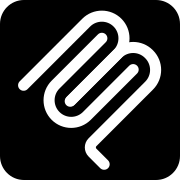
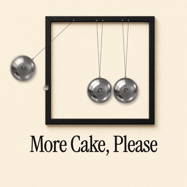
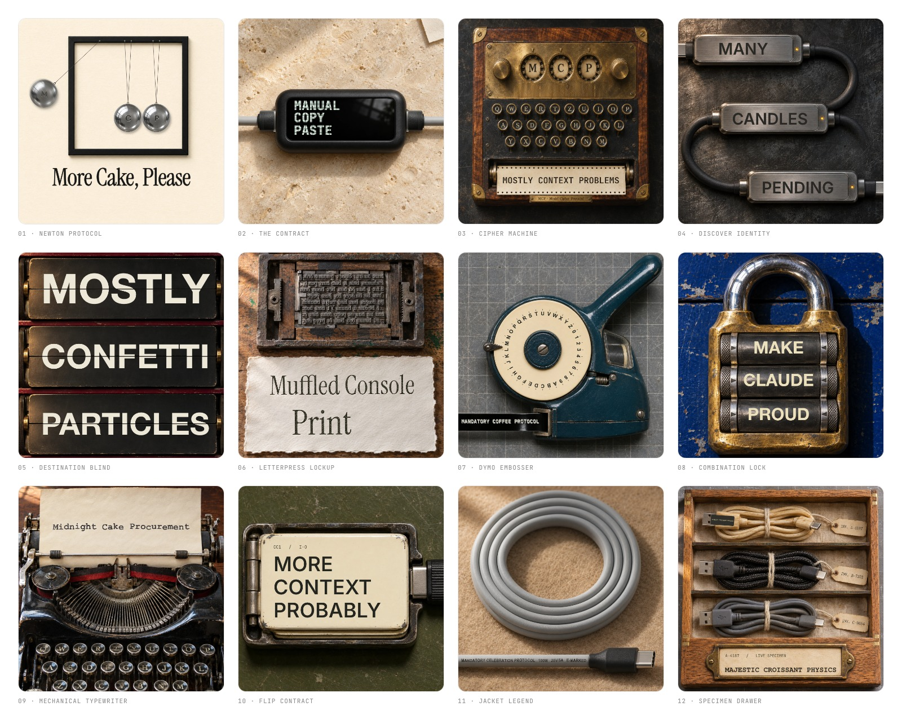
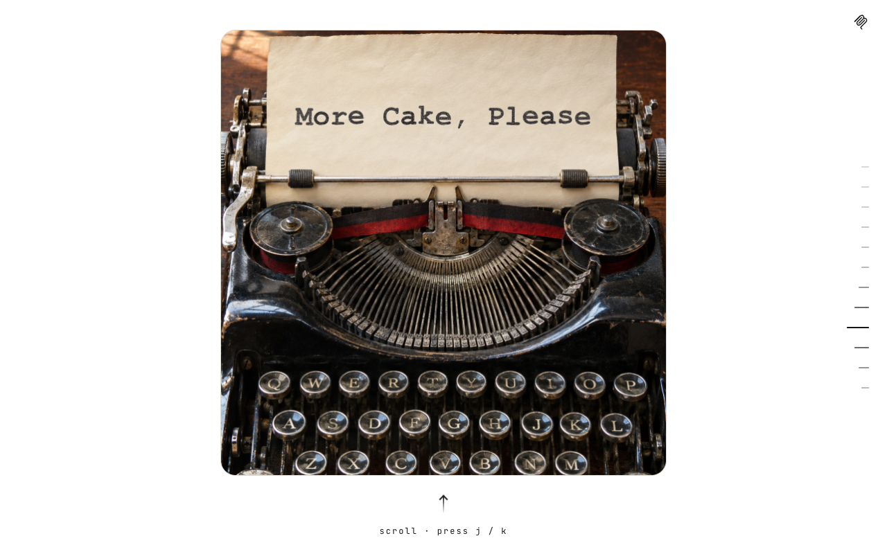
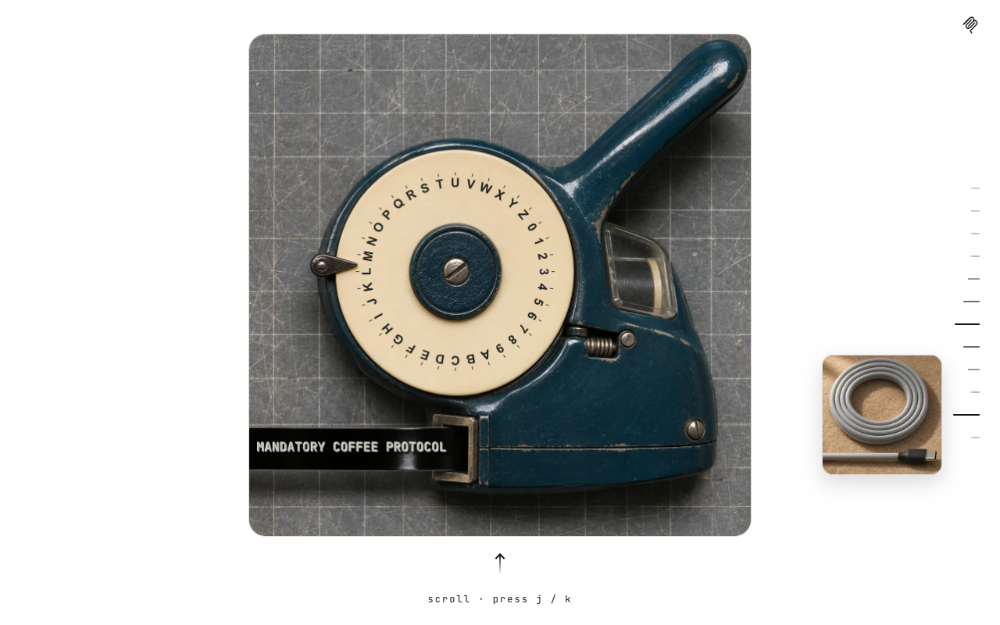
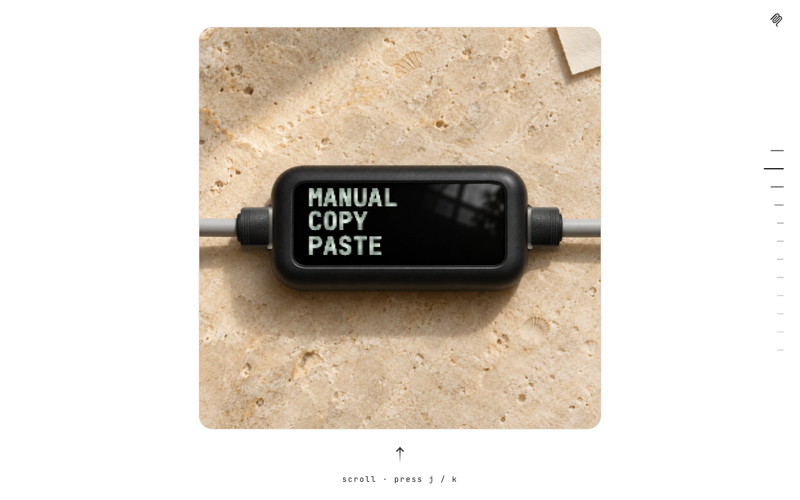

<div align="center">
  
  <h1>MCP Expansions</h1>
  <p><strong>Happy 2nd Birthday, MCP</strong> — November 25, 2024 → November 25, 2026 🎂</p>
  <p>
    Twelve tactile, clickable little toys celebrating two years of Model Context Protocol — and 85 completely unofficial things <strong>MCP</strong> actually stands for.
  </p>
</div>

<p align="center">
  <a href="proof/final/mcp-birthday-showcase.mp4">
    
  </a>
  <br />
  <sub>
    🎬 <a href="proof/final/mcp-birthday-showcase.mp4"><strong>Watch the full 1080×1080 60fps showcase video (MP4)</strong></a>
  </sub>
</p>

---

## Wait, what does MCP stand for?

Depending on the time of day, it might be:

- **More Cake, Please** — *Official birthday transport specification for November 25.*
- **Manual Copy Paste** — *The original zero-dependency context integration layer.*
- **Mostly Context Problems** — *Ninety percent of debugging, distilled into three words.*
- **Mandatory Coffee Protocol** — *Handshake must complete before any 9:00 AM standup.*
- **Make Claude Proud** — *Aspirational system prompt, rarely verified in staging.*
- **Mischievous Capybara Parliament** — *Unanimously ratified in serene hot-spring silence.*
- **Majestic Croissant Physics** — *Flaky by design, unexpectedly buttery in production.*

…plus 78 more in [`phrases.json`](phrases.json).

---

## All Twelve Instruments

Every instrument is a little physical object you can poke, drag, flip, pull, dial, or clack to deal a fresh MCP expansion:



---

## A Peek at the Site

Scroll through the gallery one quiet object at a time — or hover the tick rail on the right to jump straight to your favorite:



| | |
| :---: | :---: |
|  |  |

---

## Play With It

- **Operate any instrument:** Click, drag, or press `Space` for a fresh expansion (`Shift+Space` replays the current one)
- **Browse the collection:** Scroll, press `j` / `k` (or `↑` / `↓`), or hover and click the tick rail on the right
- **Explore all 85 phrases:** Press `/` to search and filter by mood (*Birthday*, *Protocol*, *Dev*, *Absurd*, *Skeptic*)
- **Lights out:** Press `T` to switch between light and dark mode
- **Make your own:** Add `?w=Modern,Coffee,Protocol` to the URL to render any three M · C · P words on any instrument

Want to spin it up locally?

```bash
python3 -m http.server 8000
```

Then open [http://localhost:8000](http://localhost:8000) and start clacking.

---

## Got a better M · C · P?

Drop your favorite three-word expansion into [`phrases.json`](phrases.json) and open a PR:

```json
{
  "id": "more-cake-please",
  "words": ["More", "Cake,", "Please"],
  "note": "Official birthday transport specification for November 25.",
  "category": "birthday"
}
```

---

<p align="center">
  <strong>Happy 2nd Birthday, MCP.</strong><br />
  <sub>Here’s to more context — and definitely more cake.</sub>
</p>
